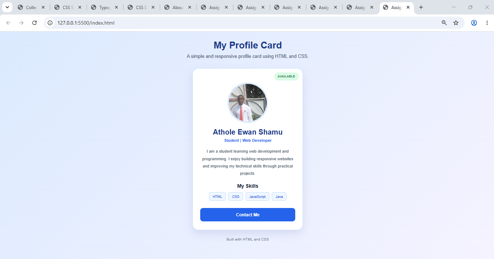

# Assignment 6.5 — Profile Card Mini-Project

Aim: To create a responsive profile card using HTML and CSS, demonstrating the CSS box model, backgrounds, borders, rounded corners, and positioning.

## 1. Important CSS concepts used

| Property                 | Purpose                                                       |
| ------------------------ | ------------------------------------------------------------- |
| `padding`                | Adds space inside the card and around its content.            |
| `margin`                 | Adds space outside elements.                                  |
| `border`                 | Creates an outline around the card and image.                 |
| `border-radius`          | Rounds the card corners and makes the image circular.         |
| `box-sizing: border-box` | Includes padding and borders in an element's specified width. |
| `position: relative`     | Makes the profile card the reference point for the badge.     |
| `position: absolute`     | Places the availability badge at the card's top-right corner. |
| `z-index`                | Controls the stacking order of overlapping elements.          |
| `@media`                 | Adjusts styling for smaller screens.                          |

## 6. Screenshot and submission

